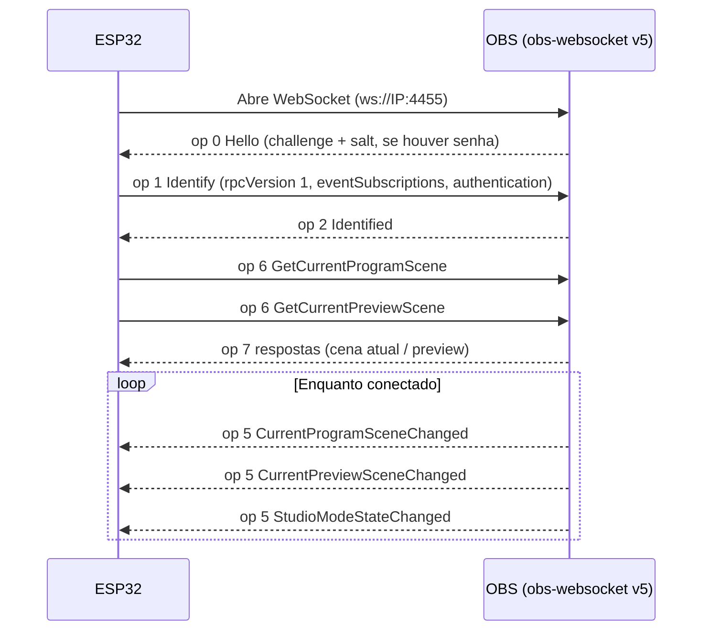

# 🔴🟢 Tally Light para OBS com ESP32 + WS2812B

Sistema de **tally light** sem fio para transmissões ao vivo. Cada ESP32 consulta o **OBS Studio** pelo protocolo **obs-websocket v5** e acende uma fita de LEDs **WS2812B** indicando o estado da câmera:

- 🔴 **Vermelho**: a câmera está **no ar** (cena em *Program*).
- 🟢 **Verde**: a câmera é a **próxima** (cena em *Preview*, com o Modo Estúdio ligado).
- ⚪ **Branco (1 LED)**: o OBS foi encontrado, mas a câmera não está no ar nem em preview.

Pensado para igrejas, eventos e pequenos estúdios: uma unidade por câmera (Câmera 1, 2, 3…), todas com o **mesmo firmware**, configuradas por uma **página web** servida pelo próprio ESP32. Não é preciso recompilar para trocar de rede, de IP do OBS ou de cena.

> **Status do projeto:** o firmware foi escrito e revisado, mas **ainda não foi validado em hardware real** no momento desta documentação. Se você testar, abra uma issue com o resultado (placa, versão do core ESP32, versão do OBS).

---

## Sumário

1. [Recursos](#1-recursos)
2. [Como funciona](#2-como-funciona)
3. [Lista de materiais](#3-lista-de-materiais)
4. [Montagem do hardware](#4-montagem-do-hardware)
5. [Instalação do software](#5-instalação-do-software)
6. [Configuração do OBS](#6-configuração-do-obs)
7. [Configuração do ESP32](#7-configuração-do-esp32)
8. [Uso no dia a dia](#8-uso-no-dia-a-dia)
9. [Referência de sinais dos LEDs](#9-referência-de-sinais-dos-leds)
10. [Solução de problemas](#10-solução-de-problemas)
11. [Detalhes técnicos](#11-detalhes-técnicos)
12. [Personalização](#12-personalização)
13. [Segurança](#13-segurança)
14. [Limitações conhecidas e próximos passos](#14-limitações-conhecidas-e-próximos-passos)
15. [Estrutura do repositório](#15-estrutura-do-repositório)
16. [Licença](#16-licença)

---

## 1. Recursos

- Programação em **Arduino (C++)**, um único arquivo `.ino`.
- Conexão ao OBS via **WebSocket v5** (OBS 28 ou superior), com suporte a **senha** (autenticação SHA-256 + Base64).
- Leitura do estado **Program** (no ar) e **Preview** (próxima câmera), em tempo real, por eventos, sem *polling*.
- **Portal de configuração** pelo Wi-Fi do próprio ESP32 (`Tally-Config`), sem cabo e sem recompilar:
  - SSID e senha do Wi-Fi
  - IP e porta do OBS
  - Senha do OBS WebSocket
  - Nome da cena (ou várias, separadas por `;`)
  - Quantidade de LEDs e brilho
  - Painel de status ao vivo
- Configuração salva na memória flash (NVS) e mantida após desligar.
- **Reconexão automática** ao Wi-Fi e ao OBS, para deixar ligado o dia todo, mesmo que o OBS seja aberto depois.
- Sinalização de inicialização e de estado de conexão pelos LEDs.

## 2. Como funciona

```
┌──────────────┐   Wi-Fi / LAN   ┌────────────────────┐
│  PC com OBS  │◄───────────────►│  Roteador / AP     │
│  (IP fixo)   │                 └─────────┬──────────┘
│  WebSocket   │                           │ Wi-Fi
│  :4455       │            ┌──────────────┼──────────────┐
└──────────────┘            ▼              ▼              ▼
                      ┌──────────┐   ┌──────────┐   ┌──────────┐
                      │ ESP32 #1 │   │ ESP32 #2 │   │ ESP32 #3 │
                      │ "Camera 1"│  │ "Camera 2"│  │ "Camera 3"│
                      └────┬─────┘   └────┬─────┘   └────┬─────┘
                           ▼              ▼              ▼
                      Fita WS2812B   Fita WS2812B   Fita WS2812B
```

Fluxo de cada ESP32:



Para cada evento, o ESP32 compara o nome da cena com a lista configurada (sem diferenciar maiúsculas de minúsculas) e atualiza a fita.

## 3. Lista de materiais

Por unidade de tally (multiplique pelo número de câmeras):

| Qtde | Item | Observação |
|---|---|---|
| 1 | **ESP32 DevKit** com USB-C (30 pinos, pinos D5, VIN, GND) | Usa o chip ESP32 clássico. **Não** é compatível com ESP8266/NodeMCU sem adaptação |
| 1 | **Fita WS2812B 5 V**, 144 LEDs/m (ou outra densidade) | Corte 16 LEDs. Ex.: 4 pedaços de 4 LEDs |
| 1 | Carregador USB **5 V / 1 A ou mais** + cabo USB-C | Alimenta o ESP32 e a fita |
| ~30 cm | Fios finos (22–26 AWG) | Vermelho, preto e outra cor para dados |
| 1 | Resistor **330 Ω** (opcional) | Em série no fio de dados |
| 1 | Capacitor eletrolítico **1000 µF / 6,3 V ou mais** (opcional) | Entre +5V e GND, perto da fita |
| – | Caixa impressa em 3D, difusor branco, suporte | Opcional |

Ferramentas: ferro de solda, estanho, alicate de corte, multímetro (recomendado), cabo USB de dados.

## 4. Montagem do hardware

Diagrama interativo e completo: [`docs/diagrama_ligacao_16leds.html`](docs/diagrama_ligacao_16leds.html). Baixe o arquivo e abra no navegador. O GitHub não renderiza HTML diretamente; você pode ativar o **GitHub Pages** para visualizá-lo online.

### 4.1 Mapa de ligações

| De | Para |
|---|---|
| ESP32 **D5** (GPIO 5) | **DI** (entrada de dados) do pedaço 1, com resistor de 330 Ω opcional no meio |
| ESP32 **VIN** | **+5V** de todos os pedaços, em paralelo |
| ESP32 **GND** | **GND** de todos os pedaços, em paralelo |
| **DO** do pedaço N | **DI** do pedaço N+1 |
| **DO** do último pedaço | Livre |

```
                      (resistor 330 Ω opcional)
ESP32 D5 ─────────────/\/\/\───────► DI  ┌──────────┐ DO ─┐
                                         │ Pedaço 1 │     │
ESP32 VIN ──┬────────────────────► +5V   │ 4 LEDs → │     │
ESP32 GND ──┼──┬─────────────────► GND   └──────────┘     │
            │  │                                          │
            │  │                    ┌─────────────────────┘
            │  │                    ▼
            ├──┼───────────────► +5V DI ┌──────────┐ DO ─► DI Pedaço 3 ─► ... ─► Pedaço 4
            │  └───────────────► GND    │ Pedaço 2 │
            │                           └──────────┘
            ...  (cada pedaço recebe +5V e GND em paralelo)
```

### 4.2 Passo a passo

1. **Corte a fita** nos pontos marcados (tarja de cobre), em pedaços de 4 LEDs. Confirme a **seta de direção** impressa em cada pedaço: os dados vão de **DI → DO**.
2. **Estanhe os pads** de cada pedaço: DI, +5V e GND na ponta de entrada e DO na ponta de saída.
3. **Solde os fios de dados em série:** DO do pedaço 1 → DI do pedaço 2, DO do 2 → DI do 3 e DO do 3 → DI do 4.
4. **Solde a alimentação em paralelo:** +5V de todos os pedaços juntos (vermelho) e GND de todos juntos (preto). Use fios curtos e grossos o suficiente.
5. **Ligue ao ESP32:** D5 → DI do pedaço 1; VIN → +5V; GND → GND.
6. **(Opcional)** Insira o resistor de 330 Ω no fio de dados, perto do ESP32 ou do primeiro LED, e o capacitor de 1000 µF entre +5V e GND, perto da fita. O **traço listrado** do capacitor é o negativo (GND).
7. **Confira com o multímetro** antes de ligar: continuidade entre os +5V, entre os GND e **ausência de curto** entre +5V e GND.
8. **Isole** as soldas (termo-retrátil ou fita) e fixe a fita antes de fechar a caixa.

> **Alternativa sem emendas:** use **um único pedaço** de 16 LEDs e dobre a fita em zigue-zague. Aí só existem as ligações de +5V, GND e D5, sem fios DO → DI.

### 4.3 Orçamento de corrente

Cada WS2812B consome até ~60 mA com R+G+B a 100 %. Uma cor pura (vermelho ou verde) consome ~20 mA por LED.

| Cenário (16 LEDs) | Corrente aproximada |
|---|---|
| Todos em branco, 100 % (pior caso) | ~0,96 A |
| Todos vermelhos ou verdes, brilho 255 | ~0,32 A |
| Todos vermelhos ou verdes, brilho 120 (padrão) | ~0,15 A |
| ESP32 com Wi-Fi (picos) | até ~0,25 A |

Como o firmware usa **vermelho/verde**, o consumo total fica em torno de **0,3 a 0,6 A**. Um carregador de **1 A** serve, e **2 A** dá folga. Por isso é seguro alimentar a fita pelo **VIN**, que entrega os 5 V do USB-C.

### 4.4 Avisos de segurança elétrica

- ⚠️ **Nunca** ligue o +5V da fita no pino **3V3**.
- ⚠️ **Nunca** ligue uma fonte externa no **VIN** com o USB conectado ao mesmo tempo.
- ⚠️ O ESP32 envia dados em **3,3 V** e o WS2812B espera ~5 V. Costuma funcionar com fio de dados curto (< 30 cm). Se o primeiro LED piscar de forma errada, use um conversor de nível (**74AHCT125** ou **74HCT245**) no sinal.
- ⚠️ Conecte o **GND primeiro** ao montar. Evite soldar ou desconectar com tudo energizado.

## 5. Instalação do software

### 5.1 Arduino IDE

1. Instale o **Arduino IDE 2.x** (<https://www.arduino.cc/en/software>).
2. Em *File → Preferences → Additional boards manager URLs*, adicione:
   ```
   https://espressif.github.io/arduino-esp32/package_esp32_index.json
   ```
3. Em *Tools → Board → Boards Manager*, procure por **esp32** (Espressif Systems) e instale.
4. Selecione a placa: *Tools → Board → esp32 → **ESP32 Dev Module***.

### 5.2 Bibliotecas

Em *Sketch → Include Library → Manage Libraries*, instale:

| Biblioteca | Autor | Versão recomendada |
|---|---|---|
| **WebSockets** | Markus Sattler (links2004) | 2.4 ou superior |
| **ArduinoJson** | Benoit Blanchon | **7.x** (o código usa `JsonDocument`) |
| **Adafruit NeoPixel** | Adafruit | 1.12 ou superior |

`WiFi`, `WebServer`, `Preferences` e `mbedtls` já vêm com o core ESP32.

### 5.3 Gravação

1. Abra [`TallyLight_OBS/TallyLight_OBS.ino`](TallyLight_OBS/TallyLight_OBS.ino). A pasta precisa se chamar `TallyLight_OBS`, igual ao arquivo.
2. Conecte o ESP32 ao PC por um cabo USB **de dados**.
3. Escolha a porta em *Tools → Port*.
4. Clique em **Upload**. Se travar em `Connecting...`, segure o botão **BOOT** da placa até começar a gravar.
5. Abra o *Serial Monitor* a **115200 baud** para ver os logs (opcional).

Repita para cada unidade. O firmware é **o mesmo** em todas.

## 6. Configuração do OBS

1. Use o **OBS Studio 28 ou superior**, que já inclui o obs-websocket v5.
2. Abra *Ferramentas → Configurações do servidor WebSocket*.
3. Marque **Ativar servidor WebSocket**.
4. Anote a **porta** (padrão `4455`). Defina uma **senha** (recomendado). Em *Mostrar informações de conexão* você vê o IP e a porta.
5. Ative o **Modo Estúdio** (botão no canto inferior direito da tela principal). **Sem ele não existe cena em preview, e a luz verde não acende.**
6. Crie as cenas com nomes claros, por exemplo `Camera 1`, `Camera 2`, `Camera 3`.
7. **Rede:**
   - Mantenha o PC do OBS com **IP fixo** (reserva de DHCP no roteador).
   - O PC e os ESP32 precisam estar na **mesma rede**.
   - Libere a porta **4455/TCP** no firewall do Windows para a rede privada, se for pedido.
   - Se o roteador tiver "isolamento de clientes" (AP isolation), **desative**.

## 7. Configuração do ESP32

1. Ligue o ESP32. Ele pisca **3 vezes branco**.
2. No celular ou notebook, conecte no Wi-Fi do ESP32:
   - **SSID:** `Tally-Config`
   - **Senha:** `tally1234`
3. Abra **<http://192.168.4.1>**.
4. Preencha os campos:

| Campo | Exemplo | Observação |
|---|---|---|
| Wi-Fi (SSID) | `RedeDaIgreja` | Rede de 2,4 GHz (o ESP32 não usa 5 GHz) |
| Senha do Wi-Fi | `********` | |
| IP do computador com OBS | `192.168.0.10` | IP fixo do PC |
| Porta do OBS WebSocket | `4455` | |
| Senha do OBS WebSocket | `********` | Vazio se o OBS não tiver senha |
| Nome da cena | `Camera 1` | Idêntico ao OBS. Aceita várias, separadas por `;` |
| Quantidade de LEDs | `16` | Conforme sua montagem |
| Brilho (1–255) | `120` | |

5. Clique em **Salvar e reiniciar**.
6. Depois do reinício, o ESP32 pisca **3 vezes azul** ao conectar no Wi-Fi. Em seguida procura o OBS.

### Exemplo para 3 câmeras

| Unidade | Nome da cena |
|---|---|
| Tally 1 | `Camera 1` |
| Tally 2 | `Camera 2` |
| Tally 3 | `Camera 3` |

Se uma câmera aparece em mais de uma cena (por exemplo, uma cena com slides), liste todas: `Camera 1;Camera 1 + Slide`.

> **Dica:** você pode configurar tudo em casa e, na igreja, só alterar o **SSID, senha do Wi-Fi e IP do OBS** pelo mesmo portal. O Wi-Fi `Tally-Config` fica sempre ativo.

## 8. Uso no dia a dia

1. Ligue os tallies (alimentação USB).
2. Abra o OBS no PC e ative o **Modo Estúdio**.
3. Os LEDs mostram a conexão (veja a [referência](#9-referência-de-sinais-dos-leds)).
4. Selecione uma cena em **Preview**: o tally correspondente fica **verde**.
5. Faça a transição para **Program**: o tally fica **vermelho**.

Os tallies podem ficar ligados o dia todo. Se o OBS for fechado, eles voltam a procurá-lo a cada 3 segundos e reconectam sozinhos quando o OBS reabrir.

## 9. Referência de sinais dos LEDs

| Situação | LEDs |
|---|---|
| Ligando | **3 piscadas brancas** (fita inteira) |
| Wi-Fi conectado | **3 piscadas azuis** (fita inteira) |
| Sem Wi-Fi | 1 LED **amarelo** piscando |
| Wi-Fi ok, OBS não encontrado | 1 LED **vermelho** fraco |
| OBS encontrado, câmera fora do ar | 1 LED **branco** |
| Câmera em **Preview** (próxima) | **Todos verdes** |
| Câmera em **Program** (no ar) | **Todos vermelhos** |

Prioridade: se a mesma cena estiver em Program e Preview, o **vermelho** vence.

A página de configuração mostra o status ao vivo (Wi-Fi, OBS, cena no ar, cena em preview). A rota `GET /status` devolve o mesmo em JSON.

## 10. Solução de problemas

| Sintoma | Causa provável | Solução |
|---|---|---|
| Nada acende | Alimentação ou D5 errados | Confira VIN, GND, D5 → **DI** (não DO) e a seta da fita |
| Cores erradas | Ordem das cores da fita | Troque `NEO_GRB` por `NEO_RGB` ou `NEO_BRG` no código |
| LEDs piscam aleatórios ou o primeiro LED falha | Sinal de 3,3 V ou ruído | Fio de dados mais curto, resistor de 330 Ω, conversor 74AHCT125 e capacitor de 1000 µF |
| Só parte da fita acende | Quebra no encadeamento DO → DI | Confira as emendas entre pedaços e a "Quantidade de LEDs" |
| Amarelo piscando | Sem Wi-Fi | Confira SSID e senha. Use rede de **2,4 GHz** |
| 1 LED vermelho fraco o tempo todo | Wi-Fi ok, OBS inacessível | Confira o IP, a porta 4455, o WebSocket ativo, o firewall e a mesma rede |
| Conecta mas não autentica | Senha do OBS errada | Corrija a senha na página |
| Nunca fica verde | Modo Estúdio desligado ou nome diferente | Ative o Modo Estúdio e confira o nome da cena |
| Nunca fica vermelho | Nome da cena não confere | O nome precisa ser idêntico. Atenção a espaços e acentos |
| Não abre `192.168.4.1` | Celular usando dados móveis ou outra rede | Desative os dados móveis e confirme que está no Wi-Fi `Tally-Config` |
| Erro de compilação em `JsonDocument` | ArduinoJson 6 | Instale o ArduinoJson **7.x** |
| Erro de compilação em `mbedtls_sha256` | Versão do core ESP32 | Atualize o core ESP32 e abra uma issue com a mensagem |
| Não grava, trava em `Connecting...` | Modo de boot | Segure **BOOT** durante o upload |

Depuração: abra o *Serial Monitor* (115200). O firmware imprime as conexões, a cena em Program e a cena em Preview.

## 11. Detalhes técnicos

### 11.1 Protocolo obs-websocket v5

| `op` | Nome | Uso no firmware |
|---|---|---|
| 0 | Hello | Recebe `authentication.salt` e `challenge`, se houver senha |
| 1 | Identify | Envia `rpcVersion: 1`, `eventSubscriptions` e `authentication` |
| 2 | Identified | Confirma e dispara as consultas iniciais |
| 5 | Event | `CurrentProgramSceneChanged`, `CurrentPreviewSceneChanged`, `StudioModeStateChanged` |
| 6 | Request | `GetCurrentProgramScene`, `GetCurrentPreviewScene` |
| 7 | RequestResponse | Cena atual / preview |

**Eventos assinados:** `eventSubscriptions = 4 | 1024` (Scenes + Ui), pois `StudioModeStateChanged` pertence ao grupo *Ui*.

**Autenticação:**

```
secret = Base64( SHA256( senha + salt ) )
auth   = Base64( SHA256( secret + challenge ) )
```

A implementação usa `mbedtls` do próprio core ESP32.

Sem o Modo Estúdio, `GetCurrentPreviewScene` retorna erro. O firmware trata isso como "sem preview" e reconsulta quando recebe `StudioModeStateChanged` com `studioModeEnabled = true`.

### 11.2 Wi-Fi e resiliência

- Modo `WIFI_AP_STA`: o ESP32 é cliente da sua rede e mantém o AP `Tally-Config` para configuração.
- `WiFi.setAutoReconnect(true)` para reconectar à rede.
- WebSocket com reconexão a cada 3 s e *heartbeat* (ping a cada 15 s, timeout de 3 s, 2 falhas) para detectar queda do OBS ou do PC.
- Ao perder o OBS ou o Wi-Fi, o estado é zerado: o tally **nunca fica preso no vermelho**.

### 11.3 Armazenamento

Preferências na NVS (`Preferences`, *namespace* `tally`): `ssid`, `pass`, `obsIp`, `obsPass`, `scenes`, `obsPort`, `numLeds`, `bright`.

### 11.4 Estrutura do código

| Bloco | Função |
|---|---|
| `Config`, `loadConfig()`, `saveConfig()` | Configuração persistente |
| `matchScene()`, `setScene()`, `setPreview()` | Lógica de comparação de cenas |
| `sha256b64()`, `makeAuth()` | Autenticação OBS |
| `onWsEvent()` | Máquina de estados do protocolo |
| `fillStrip()`, `showOne()`, `blink3()`, `updateLeds()` | Efeitos nos LEDs |
| `handleRoot()`, `handleSave()`, `handleStatus()` | Portal web |
| `setup()`, `loop()` | Inicialização e laço principal |

## 12. Personalização

| O que mudar | Onde |
|---|---|
| GPIO da fita | `#define LED_PIN 5` |
| SSID e senha do AP de configuração | `AP_SSID` e `AP_PASS` (mínimo 8 caracteres) |
| Cores dos estados | `updateLeds()` e `blink3()` (valores R, G, B de 0 a 255) |
| Ordem das cores | `NEO_GRB` no construtor de `Adafruit_NeoPixel` |
| Porta do OBS, LEDs e brilho padrão | struct `Config` |

## 13. Segurança

- **Troque a senha do AP** (`AP_PASS`) antes de usar em produção. O padrão `tally1234` é público neste repositório.
- A senha do Wi-Fi e a do OBS ficam gravadas em **texto simples** na flash do ESP32. Não use senhas que você reutiliza em outros serviços.
- O portal web **não tem autenticação** além da senha do AP, e o HTTP não é criptografado. Qualquer pessoa conectada ao AP `Tally-Config` pode alterar as configurações.
- O WebSocket do OBS usa `ws://` (sem TLS), como é padrão no obs-websocket. Use apenas em **rede local confiável**.

## 14. Limitações conhecidas e próximos passos

Limitações:

- Compatível apenas com **ESP32** (não ESP8266).
- Apenas rede de **2,4 GHz**.
- Compara **cena** em Program/Preview. Não acompanha a visibilidade de **fontes** dentro de uma cena.
- Troca de rede exige o portal (ou nova gravação).
- Ao reconectar no Wi-Fi, as 3 piscadas azuis bloqueiam o laço por ~1,5 s.
- Não foi validado em hardware real até a data desta documentação.

Ideias futuras:

- [ ] Modo por **fonte** (visibilidade de um item de cena).
- [ ] Autenticação no portal web.
- [ ] OTA (atualização de firmware sem cabo).
- [ ] Opção para apagar a fita quando o OBS estiver offline.
- [ ] Suporte a vMix e ATEM.
- [ ] mDNS (`tally1.local`) em vez de IP.

## 15. Estrutura do repositório

```
.
├── README.md
├── TallyLight_OBS/
│   └── TallyLight_OBS.ino        # firmware (Arduino)
└── docs/
    └── diagrama_ligacao_16leds.html   # esquema de ligação
```

## 16. Licença

Sugestão: **MIT**. Adicione um arquivo `LICENSE` ao repositório com o texto da licença escolhida.

---

### Créditos e referências

- [obs-websocket](https://github.com/obsproject/obs-websocket) e a [especificação do protocolo v5](https://github.com/obsproject/obs-websocket/blob/master/docs/generated/protocol.md)
- [arduinoWebSockets](https://github.com/Links2004/arduinoWebSockets)
- [ArduinoJson](https://arduinojson.org/)
- [Adafruit NeoPixel](https://github.com/adafruit/Adafruit_NeoPixel)
- [arduino-esp32](https://github.com/espressif/arduino-esp32)
